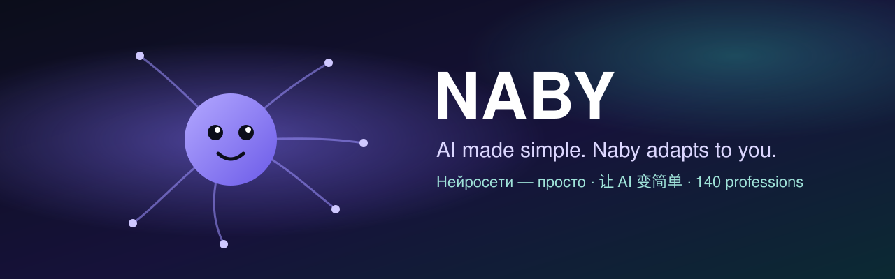

  
  
  
  

<b>English</b> · <a href="README.ru.md">Русский</a> · <a href="README.zh.md">中文</a>

---

## What is Naby

**Naby is an AI assistant that lives on your computer and adapts to you.** You don't need to understand neural networks: you say what you need, and Naby picks the models, tools and programs for your task itself — the strong cloud ones where it pays off, and a local model where privacy and cost matter.

- 🔒 **Your data stays with you.** Memory, chats and documents live on your PC; private tasks run on a local model.
- 💸 **Lower costs.** Naby routes each task to the cheapest model that does it well and shows the honest price of a big job before it starts.
- 🧩 **140 professions.** Lawyer, accountant, engineer, doctor, teacher, designer… Naby tunes its rules, task kinds, models, sources and programs to your work.
- 🛠 **It improves itself.** Whatever is missing, ask for it — Naby adds it to itself, and once a week studies GitHub, forums and news of your profession.
- 🤝 **A team when it pays off.** Parallel read-only helpers, a fresh-eyes reviewer, a task board for long jobs — and other agents via A2A, only on your rules.

## Download

| | Installer | |
|---|---|---|
| 🪟 **Windows 10 / 11** | [**Naby_Setup.exe**](https://neuralaibaby.tech/naby/dl.php?f=win) | Run it and click *Next* — Python and everything else are included |
| 🍎 **macOS 11+** | [**Naby_mac.zip**](https://neuralaibaby.tech/naby/dl.php?f=mac) | Unzip and drag *Naby.app* to *Applications* |
| 🐧 **Linux** | [**Naby_Install_Linux.sh**](https://neuralaibaby.tech/naby/dl.php?f=linux) | `bash Naby_Install_Linux.sh` |

All builds are signed by the author; Naby checks the signature of every update and updates itself. Also on the website: **[neuralaibaby.tech](https://neuralaibaby.tech/download.html)**.

## First five minutes

1. **Install and launch** — Naby asks your language right away.
2. **Pick a profession** (or skip it) — Naby looks at your computer and suggests models and programs for it.
3. **Just write** what you need. Commands help: `help`, `speed test`, `what did you do today`, `helpers`.

## Professions — open for everyone

Naby itself is the author's work, but **professions are open**: you may improve them, create new ones, change and share them under the [Naby Professions License 1.0](LICENSE.md#part-b--naby-professions-license-10).

| Folder | What's inside |
|---|---|
| [`professions/verified`](professions/verified) | ✅ **Ready and verified** by the Naby author — profile plus a calculation package with tests (10) |
| [`professions/in-progress`](professions/in-progress) | 🛠 **In progress** — the profile is ready, the package is not verified yet (130). Improve them! |
| [`professions/_template`](professions/_template) | A package template on the shared base `profbase` — start a new profession here |

- **How professions work and plug into Naby** → [docs/professions/HOW_IT_WORKS.md](docs/professions/HOW_IT_WORKS.md)
- **How to make your own and send it** → [docs/professions/CONTRIBUTING.md](docs/professions/CONTRIBUTING.md)
- **Try your profession right away:** tell Naby `install profession https://github.com/you/your-repo` — it checks it and installs it as a community profession.

The best submissions are checked by the author and shipped in the next Naby release.

## License

- **Naby (the program)** — free for personal use; work and business need a [commercial license](https://neuralaibaby.tech/commercial.html). Full text: [License Agreement](https://neuralaibaby.tech/license-en.html).
- **Professions** (`professions/`, `docs/`, `tools/`) — [Naby Professions License 1.0](LICENSE.md#part-b--naby-professions-license-10): change, create and share freely, keep the attribution.

## Links

🌐 [Website](https://neuralaibaby.tech) · 💼 [Commercial license](https://neuralaibaby.tech/commercial.html) · ❤️ [Support the project](https://neuralaibaby.tech/donate.html) · 📜 [Patents](https://neuralaibaby.tech/patents.html) · ✉️ innovate21@mail.ru

© 2026 Aleksei Pechkin · Naby — short for NeyroAIBaby

