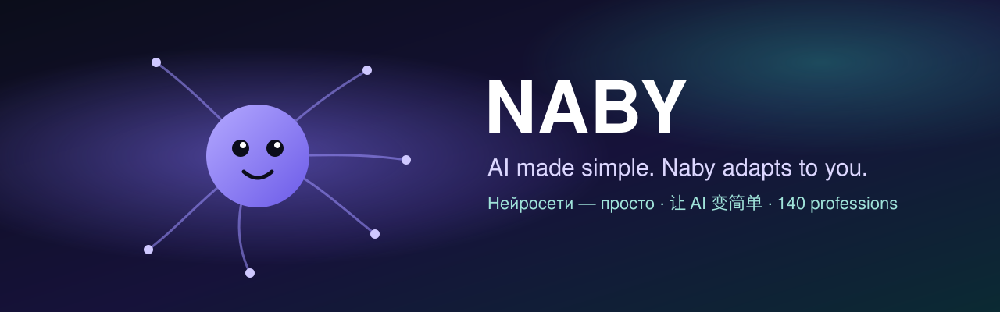

  
  
  
  
  

<a href="README.md">English</a> · <b>Русский</b> · <a href="README.zh.md">中文</a>

---

## Что такое Наби

**Наби — ИИ-помощник, который живёт на вашем компьютере и настраивается под вас.** Разбираться в нейросетях не нужно: вы говорите, что нужно, а Наби сам подбирает нейросети, инструменты и программы — сильные облачные там, где это окупается, и свою локальную модель там, где важны приватность и цена.

- 🔒 **Ваши данные — у вас.** Память, разговоры и документы лежат на вашем компьютере; приватные задачи идут на локальной модели.
- 💸 **Дешевле.** Каждую задачу Наби отдаёт самой дешёвой нейросети, которая справится, и перед большой работой честно говорит цену.
- 🧩 **140 профессий.** Юрист, бухгалтер, инженер, врач, учитель, дизайнер… Наби подстраивает правила, типы задач, нейросети, источники и программы под вашу работу.
- 🛠 **Дорабатывает себя.** Чего не хватает — попросите, Наби добавит это сам; раз в неделю изучает GitHub, форумы и новости вашей профессии.
- 🤝 **Команда, когда это окупается.** Помощники-разведчики работают одновременно, проверяющий смотрит свежим взглядом, для больших работ — доска задач, другие агенты — по протоколу A2A и только по вашим правилам.

## Скачать

| | Установщик | |
|---|---|---|
| 🪟 **Windows 10 / 11** | [**Naby_Setup.exe**](https://neuralaibaby.tech/naby/dl.php?f=win) | Запустите и нажмите «Далее» — Python и всё нужное уже внутри |
| 🍎 **macOS 11+** | [**Naby_mac.zip**](https://neuralaibaby.tech/naby/dl.php?f=mac) | Распакуйте и перетащите *Naby.app* в «Программы» |
| 🐧 **Linux** | [**Naby_Install_Linux.sh**](https://neuralaibaby.tech/naby/dl.php?f=linux) | `bash Naby_Install_Linux.sh` |

Все сборки подписаны автором; Наби проверяет подпись каждого обновления и обновляется сам. Также на сайте: **[neuralaibaby.tech](https://neuralaibaby.tech/download.html)**. · GitHub: **[Releases](../../releases)**

## Первые пять минут

1. **Установите и запустите** — Наби сразу спросит язык.
2. **Выберите профессию** (или пропустите) — Наби посмотрит ваш компьютер и предложит нейросети и программы.
3. **Просто пишите**, что нужно. Помогают команды: `помощь`, `тест скорости`, `что ты делал сегодня`, `помощники`.

## Профессии — открыты для всех

Сам Наби — работа автора, а **профессии открыты**: их можно улучшать, создавать новые, менять и распространять по [Лицензии профессий Наби 1.0](LICENSE.md#часть-б--лицензия-профессий-наби-10).

| Папка | Что внутри |
|---|---|
| [`professions/verified`](professions/verified) | ✅ **Готово и проверено** автором Наби — профиль и пакет расчётов с тестами (10) |
| [`professions/in-progress`](professions/in-progress) | 🛠 **Ещё не готово** — профиль есть, пакет не проверен (130). Дорабатывайте! |
| [`professions/_template`](professions/_template) | Шаблон пакета на общей основе `profbase` — новая профессия начинается отсюда |

- **Как устроены профессии и как они подключаются к Наби** → [docs/professions/HOW_IT_WORKS.md](docs/professions/HOW_IT_WORKS.md)
- **Как сделать свою и прислать** → [docs/professions/CONTRIBUTING.md](docs/professions/CONTRIBUTING.md)
- **Попробовать свою профессию сразу:** скажите Наби `установи профессию https://github.com/вы/ваш-репозиторий` — он проверит её и поставит как профессию сообщества.

Лучшие присланные профессии автор проверяет и выпускает в следующей сборке Наби.

## Лицензия

- **Наби (программа)** — бесплатно для себя, семьи и учёбы; для работы и бизнеса нужна [коммерческая лицензия](https://neuralaibaby.tech/commercial.html). Полный текст — [Лицензионное соглашение](https://neuralaibaby.tech/license.html).
- **Профессии** (`professions/`, `docs/`, `tools/`) — [Лицензия профессий Наби 1.0](LICENSE.md#часть-б--лицензия-профессий-наби-10): меняйте, создавайте и распространяйте свободно, сохраняя указание авторства.

## Ссылки

🌐 [Сайт](https://neuralaibaby.tech) · 💼 [Коммерческая лицензия](https://neuralaibaby.tech/commercial.html) · ❤️ [Поддержать проект](https://boosty.to/neuroaibaby/donate) · 📜 [Патенты](https://neuralaibaby.tech/patents.html) · ✉️ innovate21@mail.ru

© 2026 Печкин Алексей Владиславович · Наби (Naby) — от NeyroAIBaby

