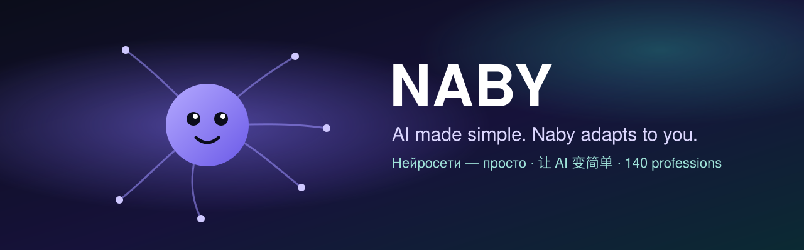

  
  
  
  
  

<a href="README.md">English</a> · <a href="README.ru.md">Русский</a> · <b>中文</b>

---

## Naby 是什么

**Naby 是运行在你电脑上、会适应你的 AI 助手。** 无需了解神经网络：你只需说出需求，Naby 会自己为任务挑选模型、工具和程序——在值得的地方使用强大的云端模型，在注重隐私和成本的地方使用本地模型。

- 🔒 **数据留在你身边。** 记忆、对话和文档都保存在你的电脑上；私密任务使用本地模型。
- 💸 **更省钱。** 每个任务交给能做好的最便宜模型，大型工作开始前如实告诉你成本。
- 🧩 **140 个职业。** 律师、会计、工程师、医生、教师、设计师……Naby 会按你的工作调整规则、任务类型、模型、资料来源和程序。
- 🛠 **自我完善。** 缺什么就提出来，Naby 会自己加上；每周研究 GitHub、论坛和你所在行业的新闻。
- 🤝 **值得时组建团队。** 只读助手并行工作，审查者以全新视角检查，大型工作用任务板；其他智能体通过 A2A 协作，且只按你的规则。

## 下载

| | 安装包 | |
|---|---|---|
| 🪟 **Windows 10 / 11** | [**Naby_Setup.exe**](https://neuralaibaby.tech/naby/dl.php?f=win) | 运行并点击“下一步”——已包含 Python 等全部依赖 |
| 🍎 **macOS 11+** | [**Naby_mac.zip**](https://neuralaibaby.tech/naby/dl.php?f=mac) | 解压后将 *Naby.app* 拖入“应用程序” |
| 🐧 **Linux** | [**Naby_Install_Linux.sh**](https://neuralaibaby.tech/naby/dl.php?f=linux) | `bash Naby_Install_Linux.sh` |

所有版本均由作者签名；Naby 会校验每次更新的签名并自动更新。网站下载：**[neuralaibaby.tech](https://neuralaibaby.tech/download.html)**。 · GitHub：**[Releases](../../releases)**

## 职业——向所有人开放

Naby 本身是作者的作品，而**职业是开放的**：你可以按照 [Naby 职业许可 1.0](LICENSE.md#part-b--naby-professions-license-10) 改进、新建、修改和分享职业。

| 文件夹 | 内容 |
|---|---|
| [`professions/verified`](professions/verified) | ✅ **已完成并经作者验证**——配置加带测试的计算包（10 个） |
| [`professions/in-progress`](professions/in-progress) | 🛠 **进行中**——配置已完成，计算包尚未验证（130 个），欢迎改进！ |
| [`professions/_template`](professions/_template) | 基于通用基础 `profbase` 的计算包模板——新职业从这里开始 |

- **职业如何工作以及如何接入 Naby** → [docs/professions/HOW_IT_WORKS.md](docs/professions/HOW_IT_WORKS.md)
- **如何制作并提交自己的职业** → [docs/professions/CONTRIBUTING.md](docs/professions/CONTRIBUTING.md)
- **立即试用：** 对 Naby 说 `install profession https://github.com/你/你的仓库`，它会检查后作为社区职业安装。

优秀的投稿会由作者审核，并随下一个 Naby 版本发布。

## 许可

- **Naby（程序）**——个人使用免费；工作和商业用途需要[商业许可](https://neuralaibaby.tech/commercial.html)。全文：[许可协议](https://neuralaibaby.tech/license-en.html)。
- **职业**（`professions/`、`docs/`、`tools/`）——[Naby 职业许可 1.0](LICENSE.md#part-b--naby-professions-license-10)：可自由修改、新建和分享，但须保留署名。

## 链接

📖 [维基](../../wiki/Home-ZH) · 🌐 [网站](https://neuralaibaby.tech) · 💼 [商业许可](https://neuralaibaby.tech/commercial.html) · ❤️ [支持项目](https://boosty.to/neuroaibaby/donate) · 📜 [专利](https://neuralaibaby.tech/patents.html) · ✉️ solpvo.tech@gmail.com

© 2026 Aleksei Pechkin · Naby——NeyroAIBaby 的简称

