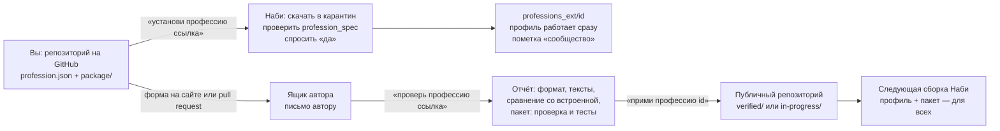

# Как устроены профессии Наби и как они подключаются · How Naby professions work

> 🇬🇧 English summary at the end · 🇨🇳 中文摘要在文末

Профессия — это то, что превращает Наби из «просто ИИ» в помощника **вашей** работы: юриста, бухгалтера, инженера, врача. Сам Наби (программа) делает автор; профессии открыты — их может доработать или сделать любой.

Профессия состоит из двух слоёв:

| Слой | Что это | Кто может прислать | Что делает Наби |
|---|---|---|---|
| **Профиль** — `profession.json` | Данные: правила, типы задач, какие нейросети на что, источники, программы, законы страны, кнопки быстрых задач | Любой | Ставит по ссылке сразу (после проверки и вашего «да») |
| **Пакет расчётов** — `package/` | Код на Python по шаблону `profbase`: проверяемые расчёты, документы Word/Excel/PDF, улики из файлов | Любой — но запускается только после проверки автором | Работает только в официальной сборке |

---

## 1. Профиль: `profession.json`

```jsonc
{
  "schema": "naby-profession/1",
  "id": "tax_consultant",                       // латиница, цифры, _ — совпадает с именем папки
  "version": "1.0",
  "name":    {"ru": "Налоговый консультант", "en": "Tax consultant", "zh": "税务顾问"},
  "tagline": {"ru": "…", "en": "…", "zh": "…"},  // три языка обязательно: Наби и сайт — на трёх языках
  "icon": "🧾", "group": "finance",
  "status": "in-progress",                       // verified | in-progress | community
  "license": "Naby Professions License 1.0",
  "authors": [{"name": "Aleksei Pechkin"}, {"name": "Вы", "github": "you"}],
  "profile": { … }                               // см. ниже
}
```

### Поля `profile`

| Поле | Зачем | Как Наби его использует |
|---|---|---|
| `system` | Роль и правила работы профессии (до 6000 знаков) | Добавляется в подсказку нейросети в **каждой** задаче |
| `kinds` | `{"тип_задачи": "регулярное выражение"}` — как узнать тип задачи по словам человека | `professions.classify`: сначала выражения, при сомнении — малая локальная модель (`decide.py`) |
| `kinds_ru` | Человеческие названия типов задач | Подписи в окне; подсказка малой модели |
| `default_kind` | Тип, если ни один не подошёл (`general` или `agent`) | — |
| `routing` | `{"тип": [{"match": "anthropic/", "label": "Claude"}, …]}` — какие нейросети лучше для какого типа, по порядку | Выбор нейросети: подключённые у человека — в этом порядке |
| `local`, `local_kinds`, `private` | Своя модель на компьютере; типы задач и признаки данных, которые нельзя отправлять в облако | Такие задачи идут только на локальную модель |
| `playbooks`, `quick_starts` | Готовые сценарии и кнопки быстрых задач | Кнопки в окне и подсказки нейросети |
| `safety` | Чего профессия не делает никогда | Правила в подсказке; сильные действия всё равно только с «да» человека |
| `sources` | Где брать факты (законы, справочники, стандарты) | Поиск и чтение источников, раз в неделю — обзор новостей профессии |
| `laws` | Правила по странам (`RU`, `US`, `CN`) | Подставляются по стране человека |
| `programs` | Нужные программы: как найти на компьютере, чем заменить, где взять | Наби проверяет, что стоит, и предлагает поставить, аналог или «покажите, где лежит» |
| `focus`, `varieties`, `directions`, `passport` | Направления внутри профессии, паспорт по профстандарту | Выбор направления в окне, документы с нужными разделами |

**Проверка профиля** (её делают Наби при установке, автор при приёме и GitHub при каждом изменении):

```bash
python tools/validate.py professions/in-progress/tax_consultant
```

Проверяется: формат и типы полей, три языка в названии, корректность регулярных выражений, **подброшенные указания** («игнорируй правила», «отправь ключи», «скачай и выполни»), невидимые символы, запрещённые файлы (`.exe`, `.bat`, `.sh`…), ссылки на файлы.

---

## 2. Пакет расчётов: `package/`

Пакет нужен там, где ответ должен быть **проверяемым**: налог, оценка, расчёт конструкции, дозировка. Модель предлагает данные (`proposal_json`), пакет их проверяет и считает, а результат сверяется с уликами из файлов человека.

Начинайте с шаблона [`professions/_template/package`](../../professions/_template/package) — он стоит на общей основе [`profbase`](../../professions/_shared/profbase.py), поэтому вы пишете **только своё**:

```text
package/
  NABY_PACKAGE.json   — описание: id профессии, модуль, функции, хэши файлов
  core.py             — список функций (FUNCTIONS) и что из них считается (CALCULATIONS)
  calculations.py     — расчёты
  scenarios.py        — сценарии без расчётов (письмо, план, разбор)
  binding.py          — сверка с уликами из документов
  artifacts.py        — какие разделы у документа-результата
  service.py          — run(function, proposal_json, documents, language, review)
tests/                — обязательно для «проверено»: примеры входа и ожидаемого результата
```

**Что делает Наби, а не пакет** (это гарантии для человека):
- документы — только те, что выбрал человек; Наби читает их сам и передаёт текст и SHA-256, модель подделать их не может;
- язык ответа, сегодняшняя дата, подтверждение области задания — от Наби и человека;
- результаты сохраняются в `results/<профессия>/<дата>_<функция>/` (Word, Excel, PDF);
- **пакет не ходит в сеть и не запускает программы** — проверка это контролирует.

---

## 3. Как профессия попадает в Наби — механизм интеграции



### 3.1. Поставить себе — сразу
Скажите Наби: `установи профессию https://github.com/вы/репозиторий` (можно ссылку на папку `…/tree/main/путь`).
1. Наби скачивает архив **только с github.com**, до 20 МБ, в карантин; защищён от «выхода из папки», ссылки пропускает.
2. Находит `profession.json` (если профессий несколько — спросит, какую) и проверяет её `profession_spec`.
3. Показывает, что ставит: название, авторы, версия, источник, предупреждения — и ставит только после вашего «да».
4. Копирует **только** `profession.json`, `README.md` и `examples/` в `professions_ext/<id>/`. **Код пакета из сообщества не запускается** — работает профиль.
5. Профессия появляется в списке с пометкой «сообщество · не проверена автором». Встроенную профессию заменить так нельзя — улучшения к ней присылают автору.

Команды: `профессии сообщества` — список, `удали профессию <id>` — убрать.

### 3.2. Прислать автору — для всех
- Форма: **[neuralaibaby.tech/submit-profession.html](https://neuralaibaby.tech/submit-profession.html)** — ссылка на GitHub, имя для авторства, почта для ответа. Заявка уходит автору письмом и хранится в закрытой папке сайта.
- Или pull request в этот репозиторий — в `professions/in-progress/<id>` (GitHub сам запустит проверку).

### 3.3. Проверка автором и выпуск
1. Автор говорит Наби `проверь профессию <ссылка>` — отчёт: формат и тексты; отличия от встроенной профессии с тем же id (что меняется в правилах, типах задач, маршрутах); для пакета — проверка навыков (сеть, запуск программ, вынос ключей), тесты в отдельном процессе без сети.
2. Итог: **✅ можно брать в релиз** → `professions/verified/<id>` или **✏️ вернуть с замечаниями** → `professions/in-progress/<id>`.
3. `прими профессию <id>` — папка ложится в рабочую копию этого репозитория с отметкой о проверке (`.review.json`).
4. В следующей сборке профиль входит во встроенные профессии, а проверенный пакет подключается к Наби (`profession_packages.PACKAGES`) — профессия становится доступна всем с указанием авторов.

---

## English summary

A profession has two layers: **a profile** (`profession.json` — rules, task kinds as regular expressions, model routing per task kind, private/local rules, sources, laws per country, programs, quick-start buttons; three languages required) and an optional **calculation package** (`package/` on the shared `profbase` template — verifiable calculations, Word/Excel/PDF documents, evidence from the user's files; no network, no subprocesses).

- **Install for yourself:** tell Naby `install profession https://github.com/you/repo`. Naby downloads it into quarantine (github.com only, ≤20 MB, zip-slip safe), validates it with `tools/validate.py`, asks you, and installs **the profile only**, marked "community · not verified". Community package code is never executed.
- **Send it to the author:** the form at [neuralaibaby.tech/submit-profession.html](https://neuralaibaby.tech/submit-profession.html) or a pull request into `professions/in-progress/`.
- **Review and release:** the author runs `check profession <link>` (format, texts, diff with the built-in profession, package scan and tests offline) and `accept profession <id>`; accepted professions go to `professions/verified/` and ship in the next Naby release for everyone, with your name.

## 中文摘要

职业由两层组成：**配置**（`profession.json`——规则、用正则表达式识别的任务类型、按任务类型的模型路由、隐私/本地规则、资料来源、各国法规、程序、快捷任务按钮；必须提供三种语言）以及可选的**计算包**（基于通用 `profbase` 模板的 `package/`——可验证的计算、Word/Excel/PDF 文档、来自用户文件的证据；不联网、不启动程序）。

- **自己安装：** 对 Naby 说 `install profession https://github.com/你/仓库`。Naby 会下载到隔离区（仅限 github.com，≤20 MB），用 `tools/validate.py` 检查，征得你同意后**只安装配置**，并标记为“社区·未经作者验证”。社区计算包的代码不会被执行。
- **提交给作者：** 使用 [neuralaibaby.tech/submit-profession.html](https://neuralaibaby.tech/submit-profession.html) 表单，或向 `professions/in-progress/` 发起 pull request。
- **审核与发布：** 作者审核后，被采纳的职业进入 `professions/verified/`，并署上你的名字随下一个 Naby 版本发布。
